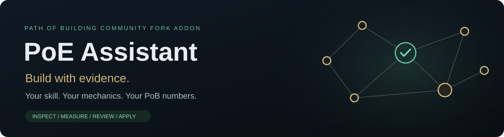
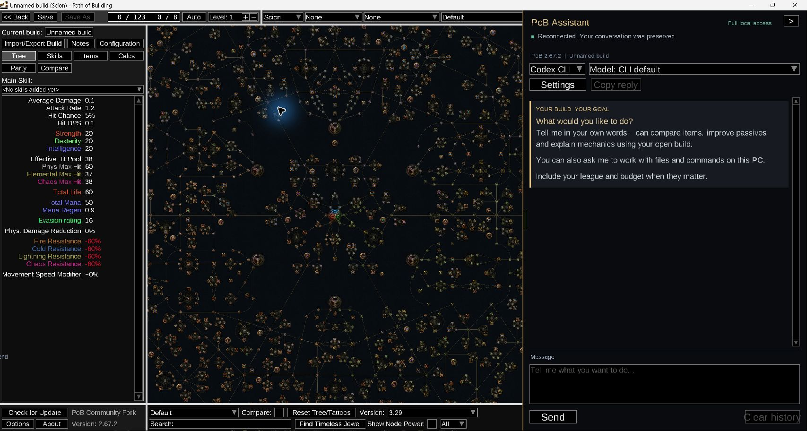
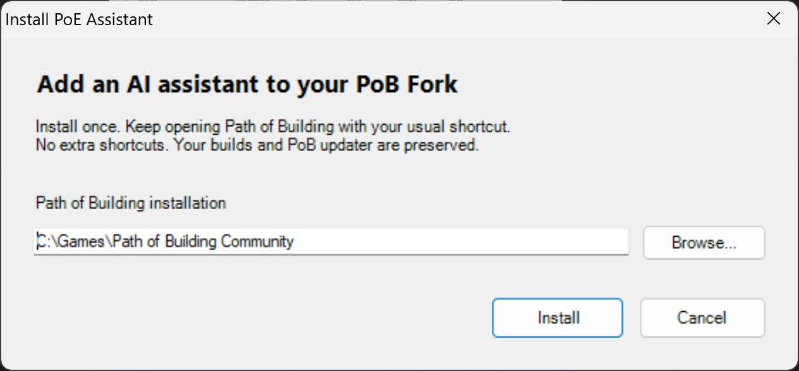
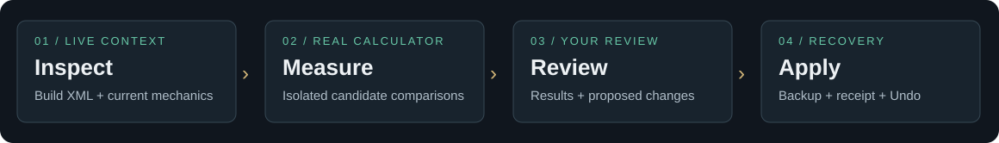

<div align="center">



**An AI build companion, inside Path of Building Community Fork.**

Ask about mechanics, compare complete builds with the real calculator, and review changes before applying them.

[](https://github.com/arthurhpabreu/poe-assistant/releases/latest)
[](https://github.com/arthurhpabreu/poe-assistant/actions/workflows/release.yml)
[](LICENSE)


[**Download the Windows installer**](https://github.com/arthurhpabreu/poe-assistant/releases/latest) · [How it works](#how-it-works) · [Documentation](docs/TECHNICAL.md) · [Report a bug](https://github.com/arthurhpabreu/poe-assistant/issues)

</div>

## Your build. Your question. Real PoB numbers.



PoE Assistant adds a resizable chat panel to your existing PoB Fork. It reads
your open build, including unsaved changes, and uses your own **Codex CLI** or
**Claude Code** installation and account. No separate addon API key is needed.

| What you can ask | What the assistant can use |
| --- | --- |
| “Build around this skill and explain the scaling.” | Installed skill data, mechanics, passive graph and current unique variants. |
| “Which setup gives more damage without losing my defenses?” | Complete candidate builds measured in isolated real PoB processes. |
| “Why is this interaction not working?” | Live XML, Calcs outputs/breakdowns and the installed PoB source. |
| “Improve my tree and items.” | Measured proposals with a visible review, recovery backup and Undo. |

## Install in three steps

1. **Save and close PoB.** Have [Path of Building Community Fork](https://github.com/PathOfBuildingCommunity/PathOfBuilding/releases) and either [Codex CLI](https://developers.openai.com/codex/cli) or [Claude Code](https://code.claude.com/docs/en/overview) installed.
2. **Run the installer from [Releases](https://github.com/arthurhpabreu/poe-assistant/releases/latest).** It detects the usual PoB folder; use Browse if yours is elsewhere, then click Install. Node.js is included.
3. **Open your usual Path of Building shortcut.** Open a build, choose your CLI/model in the panel, and start chatting. Settings → Sign in uses your provider's official login if needed.

<p align="center"></p>

The addon lives in **`<your PoB folder>\PoEAssistant`**. Setup integrates with
existing standard PoB shortcuts and removes recognized old addon shortcuts.
It creates one ordinary PoB shortcut only if none exists. There are no separate
assistant, update, rollback or uninstall desktop shortcuts.

Your builds, PoB settings and official program files are preserved. The same
installer updates an existing installation and migrates recognized older addon
settings/recovery data automatically. **Settings → Check addon updates** shows
the latest release. Save/close PoB and run the new installer to update.

Setup opens an isolated check through the integrated PoB shortcut and only
reports success after the native assistant renders a frame and connects to its
own freshly started backend. The check uses
temporary settings and does not open your saved builds. Startup errors are
shown in setup instead of leaving an apparently successful installation.

If setup fails, its error window shows the failed step and cause. **Open log**
opens the complete setup diagnostic; **Copy details** copies a support summary.
Diagnostics remain in `%TEMP%\PoEAssistant-setup-<id>` after setup closes and
include the process exit code and relevant startup logs. They do not collect
your builds, chats, provider settings or credentials.

> **On another PC:** install PoB and your chosen CLI there, then run this
> installer and sign in there. Copying old Windows shortcuts does not install
> the addon or its provider. This is a Windows x64 community addon; the current
> installer is unsigned.

## How it works



1. **Inspect.** Read the open build and installed skill/item/mechanics data.
2. **Measure.** Compare candidate XML in independent PoB calculator processes.
   Repeated exact measurements are reused within an analysis.
3. **Review.** See proposed changes, measured results and assumptions in chat.
4. **Apply.** Apply in memory after review. A backup and commit receipt confirm
   the change; failures roll back. Use PoB's Ctrl+S when you want to save.

The assistant rejects stale proposals and blocks duplicate Apply clicks. Undo
checks for later manual edits before restoring a build. It does not silently
replace a saved build file.

Drag the panel's left divider to resize it. **F8** collapses/expands it;
**Ctrl+Enter** sends a message. **Clear history** clears the conversation above
the composer and keeps your unsent draft. Model/reasoning choices are yours;
large requests can take time, and **Cancel** stops an active request.

## Current mechanics, with clear limits

- **Current and immediately previous league only.** Dated official release
  evidence gates the supported window; preview trees cannot advance it. Expired
  evidence requires a policy update. Legacy build sources/unique variants are
  excluded.
- **Measured candidates, not a promise of a global optimum.** PoB calculations
  validate modeled behavior. They do not establish every in-game interaction,
  item drop availability, crafting legality or market price.
- **Research is evidence.** Current/previous-league community builds can inform
  a hypothesis. A guide is not a substitute for measuring your proposed build.
  Sources, assumptions and unmodeled effects must be stated.

## Your account and your data

The selected CLI/provider receives the build context and requested evidence.
Its subscription, usage limits and billing apply. Login uses the CLI's official
flow; the addon does not collect passwords, copy provider credentials or switch
your accounts.

The default **Full machine access** setting lets the CLI run commands with your
Windows user's permissions. Choose **Settings → Agent access → PoB tools only**
to restrict it. PoB Undo covers changes made through the build bridge, not
arbitrary completed filesystem commands. Local chats, diagnostics and recovery
backups stay under the addon's `data` folder.

## Troubleshooting

| Symptom | What to do |
| --- | --- |
| Panel missing | Run the latest installer: it verifies the actual PoB window. Use its integrated shortcut; direct executable launches bypass it. In a small window, the visible “PoE Assistant” badge asks you to maximize PoB. |
| CLI not found | Install Codex CLI or Claude Code on this PC; restart PoB. Settings accepts an explicit `.exe` or `.js` entry if auto-detection cannot find it. |
| Login required | Use Settings → Sign in, complete your provider's login, then Check login. |
| Setup asks to close PoB | Save your build and close that PoB installation, then rerun setup. Other installations are left alone. |
| Apply fails or cannot be confirmed | Read the persistent chat error. Keep the recovery backup, check the open build, and rerun analysis before another application. |

For a bug report, include addon/PoB/Windows versions and the exact error. Remove
private build/account details before posting. See [technical documentation](docs/TECHNICAL.md)
for runtime, updates, validation and diagnostic details.

Normal startup uses bundled Node directly, with no PowerShell script execution
requirement. Unicode Windows shortcuts and explicit UTF-8 metadata reads support
user/folder names containing accents. `PoEAssistant/startup.json` records native
activation; `startup-error.log` records failures before activation. An unsupported
or blocked installation produces a diagnostic instead of a success message.

To remove the addon, close PoB and run `PoEAssistant\Uninstall.ps1` with
PowerShell. It restores owned shortcut arguments and leaves PoB, builds and
recovery data available.

## Build and contribute

```powershell
npm ci
npm test
npm run check
npm run package:windows
```

Node.js 22+ is required for development. Windows packaging includes the current
Node runtime; native integration checks require an isolated PoB copy. Read
[CONTRIBUTING.md](CONTRIBUTING.md) before changing calculator validation or the
installer. Issues and focused pull requests are welcome.

## License and credits

Original addon code and original documentation artwork are available under
the **[MIT license](LICENSE)**. Bundled dependencies retain their own notices;
see [third-party notices](THIRD_PARTY_NOTICES.md).

Built for [Path of Building Community Fork](https://github.com/PathOfBuildingCommunity/PathOfBuilding),
using your separately installed Claude Code or Codex CLI. Path of Exile and its
artwork belong to Grinding Gear Games. This independent community project is
not affiliated with or endorsed by those projects or providers.

---

<div align="center">

### Support development

If PoE Assistant helps you, consider supporting its development.


The maintainer's personal donation link will be added here.

</div>
